  

  
  
  
  
  
  

  

<picture>
  <source media="(prefers-color-scheme: dark)" srcset="./assets/sec-01-dark.svg">
  
</picture>

Profissional com mais de dez anos na interseção entre **tecnologia, dados e negócio**. Comecei em desenvolvimento web e infraestrutura, construí carreira em marketing digital e CRM e hoje atuo como **Analista de Automação Sênior**, desenhando fluxos em **n8n**, agentes de IA com **Claude, OpenAI e Gemini** e pipelines de dados em **BigQuery e Snowflake**.

Uno visão técnica e visão comercial: entendo o processo, meço o custo e entrego soluções que reduzem gastos com ferramentas. Também crio produtos próprios com IA no centro: **Elora**, **Nídia** e **Spartan OS**.

  

<picture>
  <source media="(prefers-color-scheme: dark)" srcset="./assets/sec-02-dark.svg">
  
</picture>

  

<picture>
  <source media="(prefers-color-scheme: dark)" srcset="./assets/sec-03-dark.svg">
  
</picture>

Concebidos e desenvolvidos de ponta a ponta, da arquitetura do produto à interface. Clique em um card para abrir o produto.

  
  
  

<picture>
  <source media="(prefers-color-scheme: dark)" srcset="./assets/sec-04-dark.svg">
  
</picture>

  

> Clique em cada cargo para ver os detalhes.

<b>Analista de Automação Sênior</b> · Contabilidade Facilitada &nbsp;<code>jan 2026 — atual</code>

 

- Arquitetura e desenvolvimento de fluxos de alta complexidade em **n8n**, conectando múltiplos sistemas e garantindo a integridade dos dados em escala.
- Integração de LLMs (**Claude, Gemini, ChatGPT**) nos processos de negócio, de assistentes internos a ferramentas de IA voltadas ao cliente final.
- Concepção do Fórum e de ecossistemas internos (**Lovable**); pipelines em **BigQuery** e **Snowflake** e painéis em **Tableau** para decisão em tempo real.

| ★ Nexa CRM | ★ Arena CF |
| :-- | :-- |
| CRM completo desenvolvido internamente após estudo das estruturas de RD Station, Salesforce, Blip, Omnichat e Stripe: funil e pipeline de vendas, atendimento omnicanal, pagamentos integrados e agentes de IA. Alternativa a um Salesforce orçado em **R$ 1 milhão**. | Portal interno do colaborador, feito com a área de Projetos e Processos: comunicados, jornada do colaborador, calendário Google, reconhecimento entre pares, feed do time e o chatbot de IA **“Gabs”**. |

<b>Gerente de Marketing</b> · MTC Shop &nbsp;<code>mai 2025 — jan 2026</code>

 

- Liderança da estratégia digital, de performance e de posicionamento de um e-commerce de referência em Medicina Tradicional Chinesa.
- Campanhas em Meta Ads e Google Ads, gestão de CRM, funis de conversão e fluxos de automação.
- Coordenação das equipes de conteúdo e mídia paga; otimização de site, UX e SEO; adoção de IA para produtividade.

<b>Analista de Marketing Sênior</b> · Plenum Bioengenharia &nbsp;<code>mai 2024 — abr 2025</code>

 

- Implantação e configuração do **Blip**, automatizando o atendimento conversacional e reduzindo custos de sistemas.
- Construção da identidade de marca e da presença digital, integrada ao time comercial; materiais gráficos, vídeos e renderizações 3D no KeyShot.

<b>Coordenador de Inovação e Chatbot</b> · Gallabox &nbsp;<code>nov 2023 — mai 2024</code>

 

- Liderança de projetos de chatbots personalizados para diversos clientes: arquitetura de conversação e integração com sistemas existentes.
- Desenvolvimento com **Python** e **Dialogflow**, com ganhos de satisfação e de eficiência operacional nos clientes.

<b>Automação, mídia e e-commerce</b> · Lojas Torra &nbsp;<code>set 2022 — nov 2023</code>

 

- **Analista de Automação Sênior** (mai — nov 2023): automação de chatbots, CRM e mensagens transacionais; relatórios e painéis com Power BI, GA4, Mautic, Infobip, Yourviews e VTEX.
- **Analista de Mídia Pleno** (fev — mai 2023): planejamento, compra e otimização de mídia on e off-line; gestão de equipe de analistas.
- **Analista de E-commerce** (set 2022 — fev 2023): desenvolvimento e implantação do chatbot com IA da empresa; automação, CRM e relatórios de captação e faturamento.

<b>Trajetória anterior</b> &nbsp;<code>2013 — 2022</code>

 

| Período | Cargo | Empresa |
| :-- | :-- | :-- |
| 2021 — 22 | Coordenador de Marketing e Automação | Worklover · Salesforce MC e RD Station; consultoria para Itaú, Não+Pelo e Espaço Laser |
| 2022 | Coordenador de Marketing | DBUG Telecom · leads, e-commerce e RD Station |
| 2019 — 21 | Coordenador de Marketing | Oxeliz Games Studio · jogo NStations |
| 2016 — 19 | Fundador | AReative Marketing · agência digital |
| 2013 — 16 | Membro fundador | Wnall · sites, sistemas e infraestrutura |

<picture>
  <source media="(prefers-color-scheme: dark)" srcset="./assets/sec-05-dark.svg">
  
</picture>

  <picture>
    <source media="(prefers-color-scheme: dark)" srcset="https://raw.githubusercontent.com/Alex180bart/Alex180bart/output/github-snake-dark.svg">
    
  </picture>

Gráfico de contribuições animado, atualizado automaticamente a cada 12 horas.

<picture>
  <source media="(prefers-color-scheme: dark)" srcset="./assets/sec-06-dark.svg">
  
</picture>

<b>Formação</b>

 

- **Análise e Desenvolvimento de Sistemas** · Universidade Presbiteriana Mackenzie · 2020
- **Técnico em Segurança do Trabalho** · ETEC Caieiras · 2020
- **Tecnologia da Informação** · Senac · 2012

<b>Competências</b>

 

`Mapeamento de processos` `Integrações de CRM` `E-commerce` `SEO` `Geração de leads` `Mídia paga` `Dashboards` `Liderança de equipe` `Treinamento de usuários` `Branding`

<b>Idiomas</b>

 

| Idioma | Nível |
| :-- | :-- |
| Português | nativo |
| Inglês | básico a intermediário |
| Espanhol | básico |

<b>Conteúdo e voluntariado</b>

 

- **Autor no LinkedIn:** publico sobre agentes de IA, n8n, engenharia de prompt e retorno sobre investimento em automação para mais de 1.600 seguidores.
- **Voluntário online · Nações Unidas** (UNV Online) · serviço social · desde 2015.
- **Teatro e brincadeiras com crianças** · Itaci · desde 2013.

<picture>
  <source media="(prefers-color-scheme: dark)" srcset="./assets/sec-07-dark.svg">
  
</picture>

  
  &nbsp;
  

  

<a href="#topo">↑ voltar ao topo</a>

